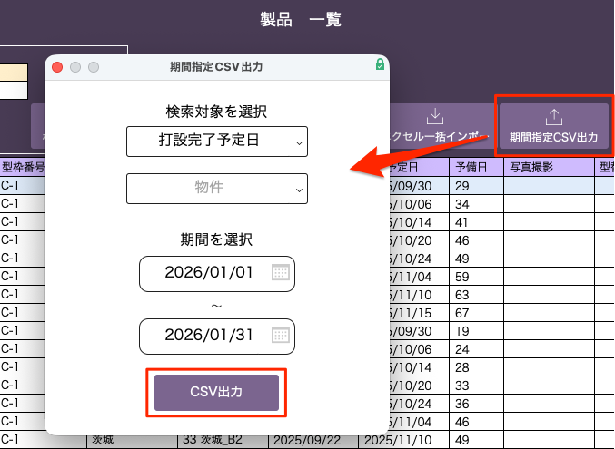
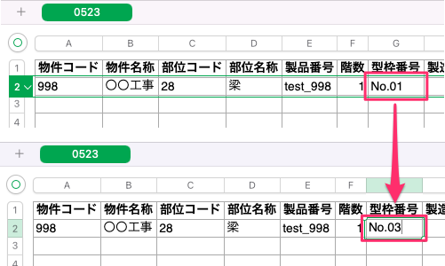
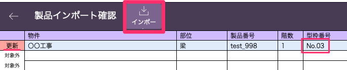

# 項目内容の更新(エクセルデータの再インポート)

{: .warning }
製品管理コードが同じ場合に同一製品と判定しているため、製品管理コードを編集した行は新規データとして登録されます。

1. 「基幹システム」トップ画面の[マスタ設定]から「製品」マスタを選択して、[製品一覧]画面から「期間指定CSV出力」を選択します。

    <table><tr><td>
    
    </td></tr></table>

2. 「期間指定CSV出力」ウインドウで以下の設定を行います。

    - **検索対象を選択**: データ抽出の基準となる日付タイプを選択します（例：打設完了予定日）
    - **物件**: 必要に応じて物件を選択します
    - **期間を選択**: 開始日と終了日を指定します
        - 終了日を空白にすることで、開始日以降のすべてのデータが出力されます
    - 「CSV出力」をクリックして、CSVファイルをダウンロードします

3. ダウンロードしたCSVファイルを開き、更新したい項目を編集し保存します。

    <table><tr><td>
    
    </td></tr></table>

4. 「基幹システム」トップ画面の[マスタ設定]から「製品」マスタを選択して、[製品一覧]画面から「エクセル一括インポート」を選択します。

5. インポートするファイルを選択して、「開く」を選択します。

6. [インポート順の指定]()を参考に設定を行い、「インポート」を選択します。

7. 「OK」を選択し、登録したい製品データの最左列に[更新]と表示されていることを確認します。  
    確認ができたら「インポート」を選択して完了です。

    <table><tr><td>
    
    </td></tr></table>